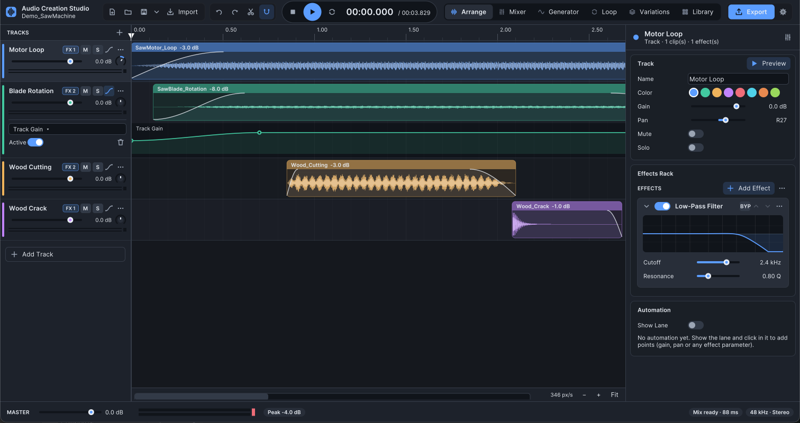
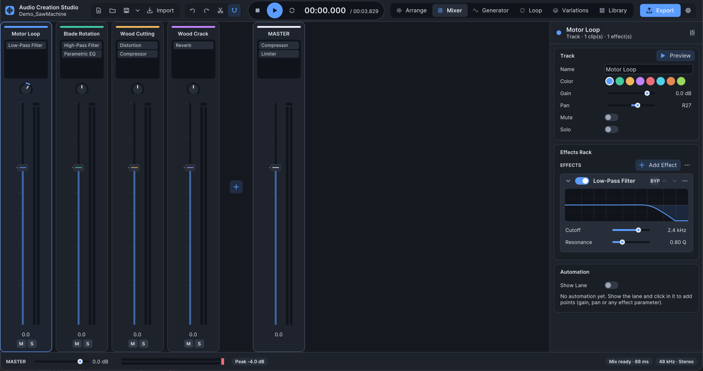
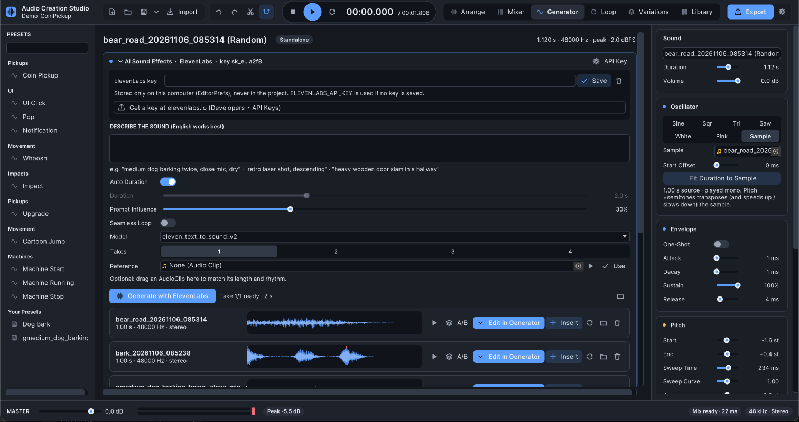
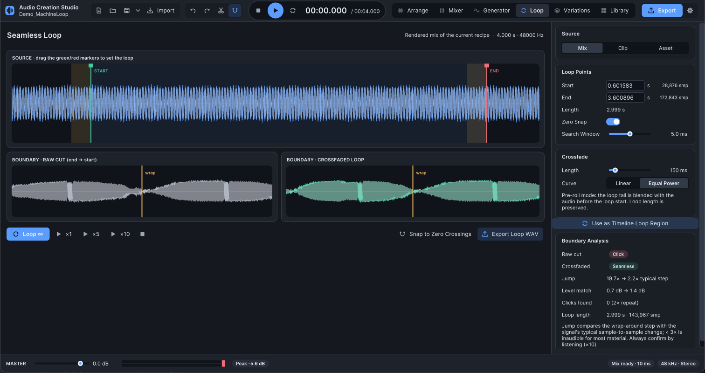
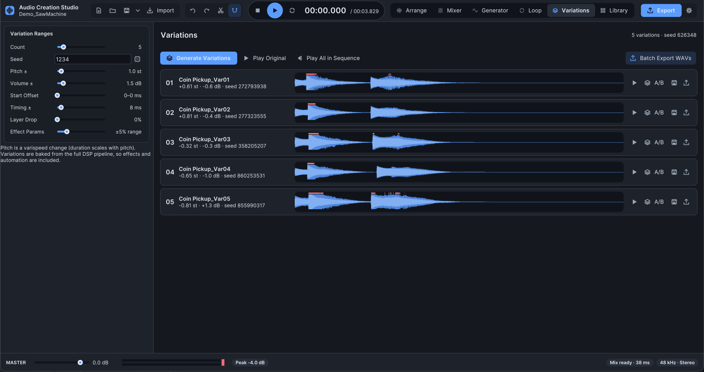
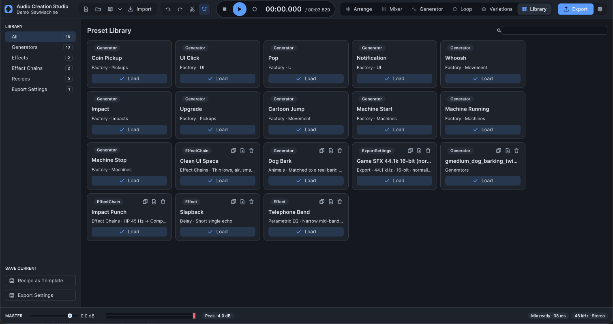
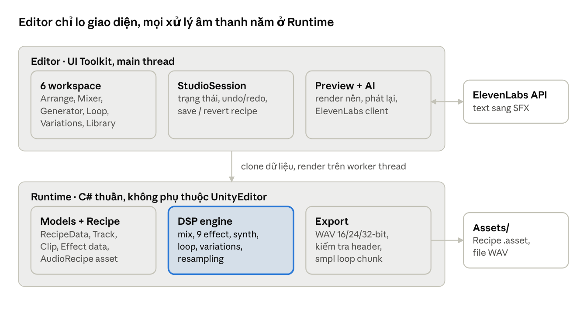

# Audio Creation Studio — Giới thiệu tool

Nov 6, 2026 · Brian

## Tổng quan

Audio Creation Studio là một mini DAW chạy ngay trong Unity Editor, giúp team tự làm sound effect cho game mà không cần rời Unity hay mở phần mềm audio riêng.

Tool gom toàn bộ quy trình vào một cửa sổ: dựng nhiều track, mix, thêm effect, tổng hợp âm thanh procedural, tạo SFX bằng AI (ElevenLabs), làm loop liền mạch, sinh biến thể và export WAV.

- **Unity:** 2022.3 LTS (phát triển và test trên 2022.3.19f1, macOS)
- **Phụ thuộc:** không có, ngoài module có sẵn của Unity (UI Toolkit, Audio). Toàn bộ DSP viết bằng C# thuần.
- **Mở tool:** `Tools ▸ Audio Creation Studio ▸ Open Studio` (⌥⇧⌘A / Ctrl+Alt+Shift+A), hoặc double-click một Audio Recipe asset.
- **Không phá file gốc:** mọi chỉnh sửa lưu trong recipe; AudioClip nguồn và import settings không bao giờ bị thay đổi.

## Tính năng chính

Tool có 6 workspace, mỗi tab phụ trách một bước trong quy trình làm SFX.

| Workspace | Làm được gì |
| --- | --- |
| Arrange | Timeline nhiều track: clip hiển thị waveform thật, trim, fade, automation lane |
| Mixer | Channel strip với fader, pan, mute/solo, danh sách effect và meter realtime |
| Generator | Synth procedural với 11 preset + card AI Sound Effects (ElevenLabs) |
| Loop | Làm loop liền mạch: crossfade, phân tích điểm nối, nghe thử ×1/×5/×10 |
| Variations | Sinh biến thể có kiểm soát, so sánh A/B, batch export |
| Library | Preset cho generator, effect, effect chain, recipe và export settings |

### Giao diện từng workspace

**Arrange** — demo Saw Machine: 4 layer, fade, automation Track Gain, Inspector và Effects Rack bên phải.

**Mixer** — mỗi track một channel strip, chain effect hiển thị ngay trên strip, master có Compressor + Limiter.

**Generator** — preset bên trái, card AI Sound Effects (ElevenLabs) với danh sách take, tham số synth bên phải.

**Loop** — marker START/END, so sánh điểm nối raw cut và crossfade, Boundary Analysis báo Click → Seamless.

**Variations** — khoảng ngẫu nhiên bên trái, 5 biến thể với waveform, A/B, lưu và export từng cái hoặc cả loạt.

**Library** — 18 preset: generator, effect, effect chain và export settings, nạp bằng một nút Load.

**Effect rack (9 effect):** Gain, Low-Pass, High-Pass, Parametric EQ, Compressor, Limiter, Distortion, Delay, Reverb. Mọi effect đều có Enable, Bypass, Reset, preset, sắp xếp thứ tự và automation tham số. Chain có thể lưu thành preset.

**Procedural Generator:** oscillator (Sine, Square, Triangle, Saw) hoặc noise, sub-osc, filter, drive, ADSR, pitch sweep/jump/vibrato. Cùng settings và seed luôn cho ra cùng một âm thanh. Preset: Coin Pickup, UI Click, Pop, Notification, Whoosh, Impact, Upgrade, Cartoon Jump, Machine Start, Machine Running, Machine Stop.

**AI Sound Effects (ElevenLabs):** mô tả âm thanh bằng tiếng Anh, tạo 1–4 take mỗi lần bấm, rồi chỉnh tiếp bằng toàn bộ công cụ của studio. Take có thể nạp vào Generator làm nguồn Sample để đổi pitch, envelope, filter và randomize ra biến thể.

**Export WAV:** PCM 16-bit, PCM 24-bit hoặc Float 32-bit. Phạm vi: Full Mix, Selected Track, Selected Clip hoặc Loop Region. Tùy chọn sample rate, mono/stereo, giữ tail, normalize, cắt khoảng lặng. File được kiểm tra header trước khi ghi đè, nên hủy giữa chừng không làm hỏng file cũ.

## Kiến trúc & cấu trúc thư mục

Tool tách làm hai lớp: Editor chỉ lo giao diện và thao tác, còn toàn bộ xử lý âm thanh nằm trong Runtime bằng C# thuần.

Main thread clone recipe và decode AudioClip, rồi worker thread render mix, synth và encode WAV. Preview phát buffer đã render sẵn, nên không có xử lý nào trên audio thread.

| Thư mục | Nội dung |
| --- | --- |
| `Runtime/` | Models, DSP (mixing, effects, generators, loop, variations), export WAV, Recipe/Preset ScriptableObject |
| `Editor/` | Cửa sổ studio, các workspace, session/undo, preview, ElevenLabs client, styling |
| `Samples/` | Recipe demo, preset, audio nguồn, file export và scene demo |
| `Tests/` | 98 EditMode test |
| `Documentation/` | Tài liệu kỹ thuật chi tiết từng module (tiếng Anh) |

Thêm effect mới: implement `IEffectProcessor` và gọi `EffectRegistry.Register(...)`. UI, preset, serialization và automation tự hoạt động mà không cần sửa thêm.

## Cài đặt & cấu hình

Tool nằm sẵn trong `Assets/AudioCreationStudio`, mở project Unity 2022.3 là dùng được, không cần cài package nào thêm.

1. Mở project bằng Unity 2022.3 LTS.
2. Vào `Tools ▸ Audio Creation Studio ▸ Open Studio` (hoặc `Window ▸ Audio ▸ Audio Creation Studio`).
3. Muốn xem ví dụ có sẵn: `Tools ▸ Audio Creation Studio ▸ Open Demo`.

**Cấu hình ElevenLabs (chỉ cần nếu dùng AI Sound Effects):**

1. Lấy API key tại elevenlabs.io ▸ Developers ▸ API Keys.
2. Dán key vào ô **ElevenLabs key** trên card AI ở đầu tab Generator.
3. Key chỉ lưu trong EditorPrefs của máy đang dùng, không bao giờ vào project hay git. Nếu chưa lưu key, tool đọc biến môi trường `ELEVENLABS_API_KEY`.

Mỗi take tốn credit của gói ElevenLabs, và quyền sử dụng audio tạo ra tuân theo điều khoản gói đó.

## Hướng dẫn sử dụng

Quy trình chuẩn: **Import → Arrange → Trim → Mix → Process → Preview → Export**. Làm SFX đầu tiên mất khoảng 5 phút.

### Từ file audio có sẵn

1. **Mở studio.** Một recipe mới mở ra với 2 track trống và limiter trên master bus.
2. **Import.** Kéo AudioClip từ Project window vào track. Thả nhiều clip dưới track cuối sẽ tự xếp thành nhiều layer. Nút **Import** cũng nhận file ngoài project (file được copy vào `Assets/AudioCreationStudio/Imported`).
3. **Arrange.** Kéo clip để di chuyển, kể cả sang track khác. Snap bật mặc định; giữ **Ctrl** để bỏ snap, **Alt**-drag để nhân bản.
4. **Trim.** Rê chuột vào mép clip rồi kéo. Audio vẫn giữ đúng vị trí thời gian.
5. **Fade.** Kéo handle tròn ở hai góc trên clip; chọn curve trong Inspector.
6. **Mix.** Dùng gain, pan, nút **M**/**S** ở header track, hoặc mở tab **Mixer**.
7. **Process.** Chọn track ▸ **Add Effect** trong Inspector (ví dụ High-Pass rồi Compressor). Thứ tự card là thứ tự xử lý.
8. **Preview.** Bấm **Space**. Sửa trong lúc phát sẽ được render nền, âm thanh mới phát tiếp không ngắt. Double-click clip để nghe riêng clip đó.
9. **Export.** Bấm **Export** (góc phải trên), chọn *Full Mix*, *PCM 16-bit*, thư mục trong `Assets` ▸ **Export WAV**. File tự được import.
10. **Save.** Lưu recipe thành asset để mở lại và sửa bất cứ lúc nào.

Chưa có audio? Click phải lên lane trống ▸ **Insert Generated ▸ Pickups ▸ Coin Pickup**.

### Tạo bằng AI (ElevenLabs)

1. Vào tab **Generator**, card AI ở trên cùng.
2. Mô tả âm thanh bằng tiếng Anh, tả chính âm thanh, ví dụ "medium dog barking twice, close mic, dry". Tránh câu lệnh ("make…") và từ tượng thanh ("woof woof") vì dễ bị đọc thành giọng nói.
3. Chỉnh tùy chọn: Auto Duration hoặc 0.5–30 s, Prompt Influence (mặc định 30%), Seamless Loop, Model (`eleven_text_to_sound_v2` hoặc v3), số Takes 1–4.
4. (Tùy chọn) Kéo một clip vào **Reference**: tool khớp độ dài và thêm gợi ý nhịp vào prompt.
5. Bấm **Generate with ElevenLabs**. Take được lưu vào `Assets/AudioCreationStudio/Generated/ElevenLabs/` kèm file `.txt` ghi lại prompt và settings.
6. Với mỗi take: ▶ nghe, **A/B**, **Edit in Generator ↓**, **Insert** vào timeline, **Loop** để mở trong Loop editor, hoặc xóa.

### Làm loop và biến thể

- **Loop:** chọn nguồn (Mix, Clip, Asset), kéo marker START/END (tự bắt zero crossing), đặt crossfade, xem Boundary Analysis, nghe ×10 rồi **Export Loop WAV**.
- **Variations:** đặt khoảng ngẫu nhiên cho Pitch, Volume, Timing, Layer Drop, Effect Params ▸ **Generate** ▸ nghe A/B ▸ **Batch Export WAVs**. Cùng seed luôn cho cùng bộ biến thể.

## Recipes & demo

Mọi âm thanh làm trong tool được lưu dưới dạng **Audio Recipe**: một ScriptableObject mô tả cách dựng âm thanh, không phải file audio đã render.

- Recipe chứa track, clip, effect, automation, generator settings, loop region, export settings và cài đặt variations.
- Clip nguồn là tham chiếu Unity bình thường (GUID), nên đổi tên hay di chuyển file không làm hỏng recipe.
- Nguồn bị thiếu sẽ phát ra im lặng và hiện clip màu đỏ "Missing source".
- Tạo mới: `Create ▸ Audio Creation Studio ▸ Audio Recipe`, hoặc **Save** trong studio.

Có 4 demo mở từ `Tools ▸ Audio Creation Studio ▸ Demos`. Toàn bộ audio nguồn do chính tool tổng hợp, không dùng asset bên thứ ba.

| Demo | Minh họa | Output |
| --- | --- | --- |
| A · Saw Machine | 4 layer từ WAV, loop clip, trim, fade, pan, gain automation, LP/HP/EQ/Distortion/Compressor/Reverb, master limiter | `SawMachine_Final.wav` |
| B · Coin Pickup | Square osc với pitch jump, ADSR, layer lấp lánh, ping-pong delay, normalize khi export | `CoinPickup_Final.wav` |
| C · Seamless Machine Loop | Loop point bắt zero crossing, crossfade equal-power 150 ms | `MachineLoop_Final.wav` |
| D · UI SFX Pack | Generator preset, layer hai tông, tremolo gating | `UI_Click.wav`, `UI_Confirm.wav`, `UI_Error.wav`, `Upgrade.wav` |

File export nằm ở `Samples/Demo/Exports/`. Scene demo `Samples/Demo/AudioStudioDemo.unity`: vào Play Mode rồi bấm phím 1–7 để nghe trong game.

## Lưu ý & giới hạn

Tool hợp với SFX ngắn (vài giây đến khoảng 1 phút); một số điểm cần biết trước khi dùng:

- **Không có tiếng?** Unity đôi khi mất thiết bị output (sleep, đổi tai nghe/Bluetooth). Dùng ⚙ ▸ *Reset Audio Output*, không được thì khởi động lại Unity.
- **Preview dùng chung kênh với Inspector:** bấm ▶ trên một AudioClip trong Inspector sẽ dừng playback của studio; bấm Play lại là được.
- **Render offline:** preview render cả bản mix, giới hạn 10 phút.
- **Định dạng nguồn:** WAV đọc trực tiếp. MP3/OGG/AIFF/FLAC cần *Load Type = Decompress On Load*; tool báo lỗi chứ không tự đổi settings.
- **Pitch variation là varispeed:** pitch và độ dài đổi cùng nhau, chưa có time-stretch.
- **Generator là mono;** độ rộng stereo đến từ pan, ping-pong delay và reverb.
- **Loop metadata:** Unity bỏ qua chunk `smpl`, nên cần bật *Loop* trên AudioSource. Wwise, FMOD và hầu hết DAW đọc được chunk này.
- **ElevenLabs:** cần internet và API key riêng; chỉ nhận text, reference chỉ ảnh hưởng qua độ dài và gợi ý text.
- **Nền tảng đã kiểm chứng:** Unity 2022.3.19f1 trên macOS. Windows/Linux và Unity 6 chưa test.

**Chất lượng:** 98 EditMode test bao phủ DSP, effect, generator, loop, variations, WAV export và ElevenLabs client (offline). Chạy tại `Window ▸ General ▸ Test Runner ▸ EditMode`.

**Roadmap:** chưa có kế hoạch chính thức. Các điểm trên (time-stretch, oversampling cho Distortion, lookahead cho Limiter, hỗ trợ Windows/Unity 6) là ứng viên tự nhiên cho bước tiếp theo.
